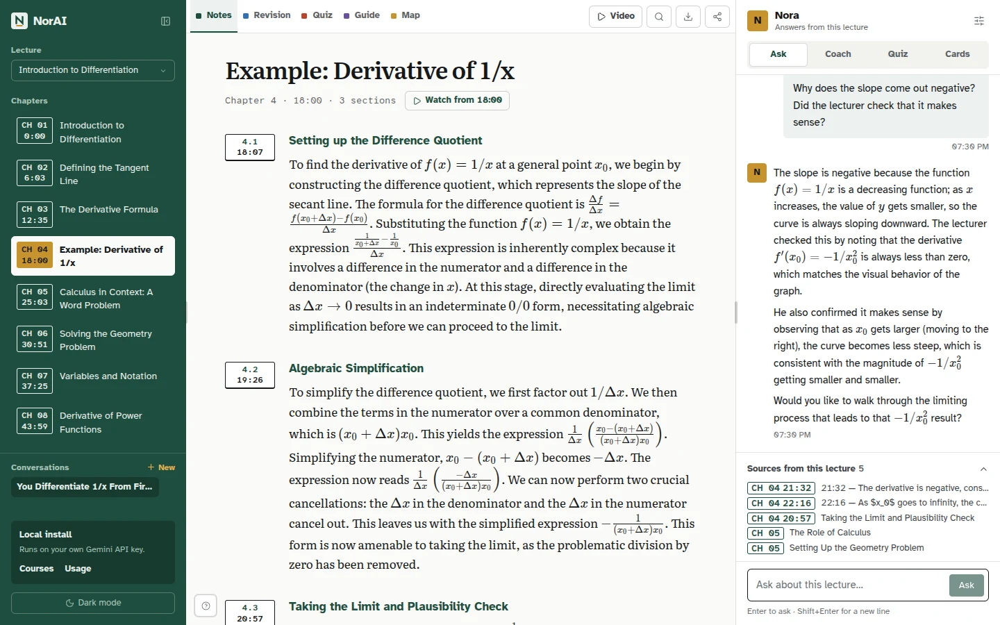
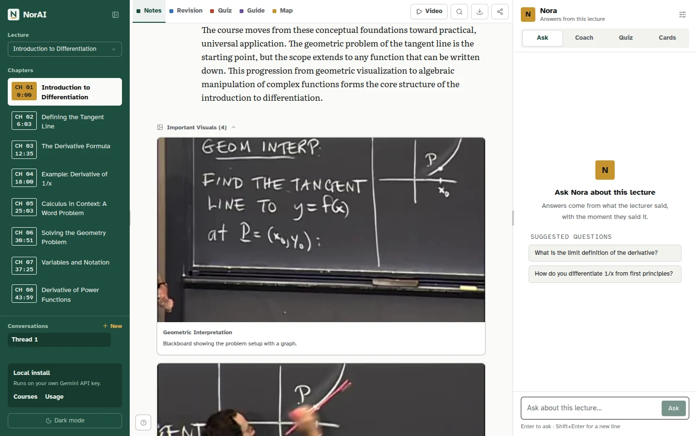
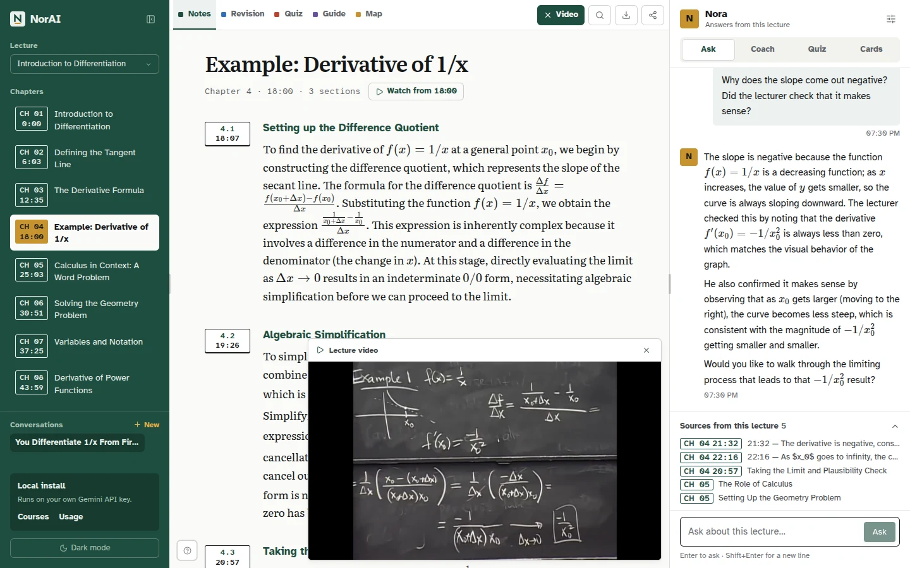
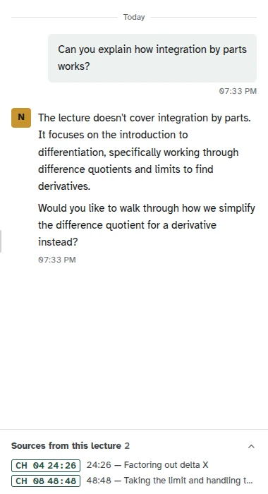
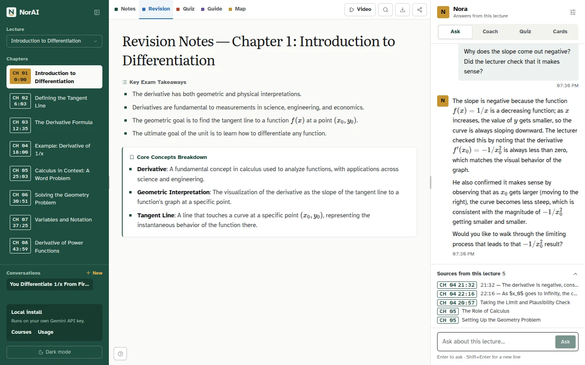
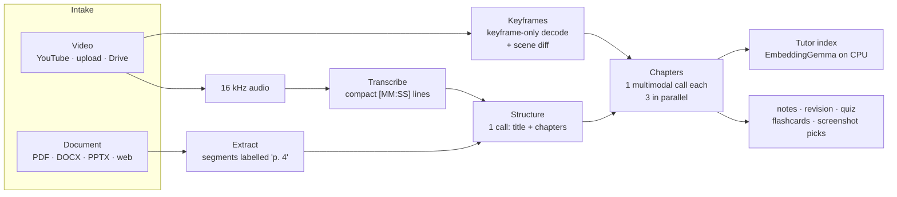
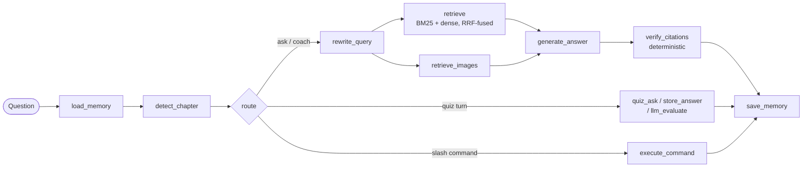
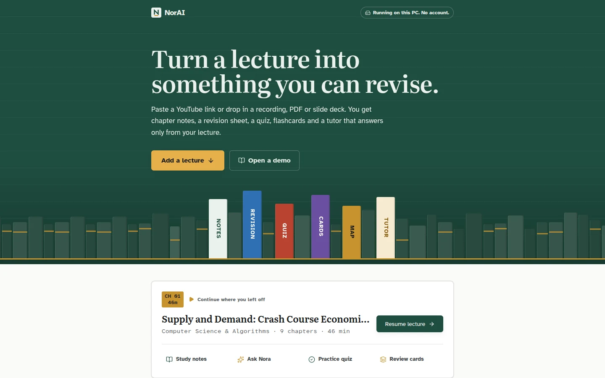

<div align="center">

# NorAI

### Turn a lecture into something you can revise.

**Give it a lecture video, recording, PDF or slide deck. You get chapter notes with
the lecturer's own slides and board work, a revision sheet, quizzes, spaced-repetition
flashcards, a mind map, and Nora: a tutor that answers only from that lecture and
cites the second it was said.**

[](https://www.python.org/)
[](https://fastapi.tiangolo.com/)
[](https://react.dev/)
[](https://www.typescriptlang.org/)
[](https://ai.google.dev/)
[](https://www.langchain.com/langgraph)
[](LICENSE)

[Tour](#a-tour) · [Results](#measured-results) · [Engineering](#how-it-works) · [Run it](#run-it-on-your-own-pc) · [Docs](#docs)

</div>



<p align="center"><sub>MIT 18.01, Lecture 1. Chapters on the left, notes with rendered math in the middle, and Nora on the right
answering a follow-up. Each source chip (<code>CH 04 21:32</code>) is a timestamp from the transcript, checked before it is shown.</sub></p>

## Why it's different

Most "chat with your lecture" tools summarize a transcript and answer from general
knowledge. NorAI keeps every output tied to the lecture.

| | |
|---|---|
| 🎯 **Grounded** | Nora answers from the lecture's transcript, notes and slides. A deterministic post-check removes any citation that isn't in what was retrieved. When the lecture doesn't cover something, Nora says so. On a 66-question eval set, **98–100 % of citations verify** and out-of-scope questions are declined. |
| 🎞️ **Multimodal** | Notes are written from the transcript *and* the video's keyframes in the same call, so the blackboard derivation or the slide diagram lands next to the paragraph that explains it. |
| ⏱️ **Timestamped** | Every note section, quiz explanation and tutor citation jumps the docked player to that moment. Transcript timestamps land a **median 0.4 s** from YouTube's own captions. |
| 💸 **Cheap** | A 17-minute lecture costs **$0.034 in 9 Gemini calls** end to end. Embeddings run on the machine with a 4-bit ONNX model, so tutor indexing uses no API quota. |
| 🖥️ **Runs on your PC** | `NORAI_MODE=local`: no account, no quotas, SQLite, your own Gemini key. The same codebase runs the hosted multi-user version. |

## A tour

### Notes that keep the board work



Chapters follow the order the lecture was taught (about one per 4 minutes), and each
section carries its start time. The chapter call picks the keyframes that matter,
captions them and OCRs them, so a slide shown for four seconds still ends up in the notes.
Math is rendered with KaTeX.

### Every answer links to the moment



Clicking `CH 04 21:32` in Nora's sources opens the docked player at 21:32, on the board
where the derivation is written. Note sections and quiz explanations work the same way.

### Knows what it wasn't taught, quizzes you, and schedules your reviews

<table>
<tr>
<td width="33%" valign="top"><br><sub><b>Grounded refusal.</b> Asked about integration by parts in a lecture that never mentions it, Nora says so and offers what the lecture does cover.</sub></td>
<td width="33%" valign="top"><br><sub><b>Quiz mode.</b> MCQ, true/false and short-answer per chapter. Short answers are graded by the LLM, and every question links to where it is covered in the notes.</sub></td>
<td width="33%" valign="top"><br><sub><b>Flashcards.</b> SM-2 spaced repetition with Due and Missed filters, and one-click <b>Anki <code>.apkg</code> export</b>.</sub></td>
</tr>
</table>

<table>
<tr>
<td width="50%" valign="top"><br><sub><b>Revision sheet.</b> Exam takeaways and core concepts per chapter. The Study Guide joins them into one document.</sub></td>
<td width="50%" valign="top"><br><sub><b>Mind map.</b> A concept map per chapter, as a tree or radial layout, exportable.</sub></td>
</tr>
</table>

<details>
<summary><b>Everything you get from one lecture</b></summary>

| | |
|---|---|
| **Study notes** | Chapter by chapter, with the slides and board frames that mattered, each section timestamped |
| **Revision sheet & study guide** | A dense per-chapter summary, plus one joined document for the night before |
| **Quiz** | MCQ, true/false, short-answer and conceptual questions with difficulty filters, a step-by-step mode, confidence tracking and a history of missed questions |
| **Flashcards** | SM-2 scheduling, Due and Missed filters, Anki `.apkg` export |
| **Mind map** | Per chapter, tree or radial |
| **Nora** | **Ask** mode answers; **Coach** mode guides you with questions. Replies in the language you write in. **Highlight & Ask** on any selected text in the notes |
| **Click-to-video** | Every timestamp jumps the docked player |
| **PDF export** | Notes, revision, quiz and mind map |
| **Library, courses, sharing** | A home that surfaces due cards and missed questions, courses that group lectures, and share links that expose only sanitized content (no transcript, no answer key, no tutor) |
| **Usage page** | Per-stage Gemini token and cost breakdown |

</details>

### Inputs

- **Video:** YouTube links, uploads (MP4, MOV, MKV, AVI, WebM), Google Drive links.
- **Documents:** PDF, DOCX, PPTX, TXT, Markdown, web pages, Google Docs/Slides and Dropbox links. Text is extracted (scanned PDFs go through Gemini), turned into transcript-shaped segments with a location label (`p. 4`, `Slide 7`), and then runs through the same content stages as video. Citations point at the page or slide instead of a timestamp.

## Measured results

The pipeline was rebuilt from an 18-stage chain into the lean design described below.
The same lectures were measured before and after. Quality was judged by `gemini-3.8-flash`
against the transcript. Full method and caveats: [`docs/PHASE2_REPORT.md`](docs/PHASE2_REPORT.md).

| | Old 18-stage chain | Current pipeline |
|---|---|---|
| 17-min lecture, full run | 29 calls · $0.061 · 242 s | **9 calls · $0.0335 · 142 s** |
| Unsupported claims in notes | 2.5–19 % | **0–2.8 %** |
| Transcript timestamps vs YouTube captions | drifted to −73 s by minute 16 | **median 0.4 s, p90 0.9 s** |
| Tutor: detail-question accuracy | 0 – 1.0 | **1.0 on all three sets** |
| Tutor: citations that verify | 58–66 % | **98–100 %** |
| Tutor: p50 latency per turn | 5.5–7.1 s | **3.9–4.3 s** (≈ $0.0008 per turn) |
| Tutor index on disk | 6.3–6.8 MB (Chroma) | **96–464 KB** (NumPy) |
| Frame decode, 71-min 720p, 1 core | 88 s | **15 s** |

A 52-minute MIT lecture went end to end through the UI in 449 s for $0.099.

## How it works

### The pipeline



Transcription and keyframe extraction run in parallel. After them there are only two
kinds of LLM call:

1. **Structure:** one call over the transcript chooses the title, how many chapters there are and where they start and end.
2. **Chapters:** one multimodal call per chapter. It receives the chapter's transcript and up to 12 of its keyframes, and returns notes (each section with its start time), revision, quiz, flashcards and screenshot picks with OCR, as one structured response.

The old chain made separate calls for extraction, visual analysis, outline, chapter
building, screenshot selection and notes. Each step re-sent context and added textbook
padding the lecturer never said. Merging them cut cost by 45 % and unsupported claims
to near zero.

**Choices that made this work:**

- **Compact transcription.** Gemini writes one `[MM:SS] text` line per sentence instead of JSON. Output tokens drop 60 %, and it kept 2,948 of 2,949 words. Long lectures are cut into 18-minute slices and transcribed in parallel.
- **Keyframe-only decoding.** FFmpeg decodes only the encoder's keyframes, which encoders place at scene cuts, and a pixel-diff pass removes duplicates. That costs about 0.28 CPU-seconds per lecture minute, and short slides are caught that a fixed 8 s grid only hit by luck.
- **Content-hashed caching.** Chapter results are cached by a hash of their inputs, so a re-run only pays for what changed. A chapter that fails is marked *degraded* instead of failing the lecture, and one invalid quiz question is dropped on its own instead of losing the chapter.
- **Durable jobs, no SSE.** The pipeline runs synchronously in a worker thread owned by a DB-backed queue (`backend/jobs.py`). Jobs survive restarts (orphans are recovered in about 90 s), progress is saved on the lecture row, and the frontend polls it.
- **Cost known up front.** `POST /estimate` predicts calls and minutes before you start, and recalibrates from recorded runs.
- **Overload handling.** One Gemini client (`backend/gemini_client.py`) owns timeouts, RPM limits and retries, and honours the server's retry-after on 429s. After two 503s in a row it switches to a fallback model for five minutes.
- **Cleanup.** Video, audio and raw frames are deleted after success, failure or cancel.

### The tutor



- **LangGraph state machine** per lecture with async nodes and an `AsyncSqliteSaver` checkpointer, so conversations persist across restarts and turns never block the event loop. Tokens stream through `graph.astream_events`.
- **Hybrid retrieval.** About 45 s transcript windows, note sections and screenshot captions are retrieved with BM25 and dense cosine together, fused with reciprocal rank fusion. The query is first rewritten using the conversation so follow-ups like "why is it negative?" resolve. Image retrieval runs in parallel, so Nora can look at the actual slide.
- **Coverage decision.** The answer node decides whether the lecture covers the question, partly covers it, doesn't cover it, or the question rests on a false premise, and replies accordingly. False-premise correction scored 1.0 on every eval set.
- **No made-up citations.** `verify_citations` checks each cited source against the chunks actually retrieved that turn. No LLM is involved, and unverified citations are never rendered.
- **A vector store built to fit the problem.** One lecture is a few hundred documents, so `tutor/vector_store.py` is a float16 NumPy matrix plus `docs.json` with exact cosine search, 100–450 KB per lecture. Chroma was removed.
- **On-box embeddings.** EmbeddingGemma 300M (4-bit ONNX, multilingual, 768-d) embeds a 52-minute lecture in about 75 CPU-seconds on one thread. Document ids are content hashes, so re-indexing unchanged content embeds nothing. Each index records its model, and relevance thresholds are set per model, so local and Gemini-embedded lectures can coexist.
- **Evaluated, not eyeballed.** `tutor/evals/` holds golden question sets, an answer judge, a notes-fidelity judge and a timestamp checker against YouTube captions. Those numbers are the "Measured results" above.

### Security

- Every server-side fetch of a user URL goes through one SSRF-guarded download function (`documents/fetch.safe_download`).
- JWT verification and webhook signatures fail closed (ES256 via JWKS, HS256 fallback).
- Quota is checked before any Gemini spend, and again on the real downloaded media length.
- Uploads are validated and size-limited. Raw errors go to logs, and clients get generic messages.
- Share links are off by default and expose sanitized content only.
- The backend refuses to start in local mode when `NORAI_ENV=production`, because local mode turns off ownership checks.

### By the numbers

~30k lines of Python and ~19k of TypeScript · 51 offline Python test scripts + 18 Vitest
suites, run in CI with oxlint, pyflakes and a type-checked build · single-container Docker
image with the embedding model built in · ~200 MB backend RSS.

## Run it on your own PC

You need Python 3.12+, Node.js 20.19+, FFmpeg and a free
[Gemini API key](https://aistudio.google.com/apikey).

```bash
git clone https://github.com/GouravLuinor/NorAI.git
cd NorAI
scripts/setup-local.sh        # installs everything, downloads the embedding model, asks for your key
scripts/start-dev.sh start    # open http://localhost:5173
```



The setup script writes `.env` with `NORAI_MODE=local`. Five processed demo lectures
(MIT OpenCourseWare and Yale, CC BY-NC-SA) are included, so you can try the workspace
and the tutor before processing anything. Processing uses your own Gemini quota, and
the free tier covers a few long lectures a day. Google's free tier isn't offered in
the EEA, UK or Switzerland, where the key needs billing.
`scripts/start-dev.sh stop` shuts it down.

### One codebase, two modes

| | `local` | `hosted` (default) |
|---|---|---|
| `NORAI_MODE` | One user, no login, no quotas, SQLite | Supabase auth + Postgres, quotas, rate limits |
| `NORAI_SOURCES` | `youtube,gdrive,upload,link` | `gdrive,upload,link` (YouTube blocks server IPs) |
| Free allowance | n/a | 60 lecture-minutes every 30 days (`NORAI_FREE_MINUTES`) |
| Payments | n/a | Razorpay integration present, off by default (`ENABLE_PAYMENTS=0`) |

There are no edition branches: the frontend reads both settings from `GET /system/config`.
Details: [`docs/INGESTION_PLAN.md`](docs/INGESTION_PLAN.md). Hosted setup:
[`SUPABASE_SETUP.md`](SUPABASE_SETUP.md) and [`docs/DEPLOYMENT_PLAN.md`](docs/DEPLOYMENT_PLAN.md)
(single container, Caddy, Supabase).

## Tech stack

| Layer | Technology |
|---|---|
| **Frontend** | React 19, TypeScript, Vite 8, Tailwind CSS 4, Zustand, React Router, React Markdown, KaTeX, Framer Motion |
| **Backend** | FastAPI, Uvicorn, SQLAlchemy (async), Alembic |
| **AI** | Gemini `gemini-3.1-flash-lite` (transcription, structure, chapters, tutor); EmbeddingGemma 300M on ONNX Runtime (`gemini-embedding-2` optional) |
| **Tutor** | LangGraph, LangChain, NumPy vector store, BM25 |
| **Media & documents** | FFmpeg, OpenCV, yt-dlp, gdown · pypdfium2, python-docx, python-pptx, trafilatura |
| **Auth & data** | Supabase (JWT via JWKS, Postgres) hosted; SQLite local; artifacts on the file system |
| **Export** | genanki (Anki), browser print pipeline (PDF) |
| **Tooling** | oxlint, Vitest, standalone offline test scripts, GitHub Actions CI, Docker |

<details>
<summary><b>Repository layout</b></summary>

```
NorAI/
├── config.py            # single source of truth: model, dirs, run mode, sources, quotas
├── backend/             # FastAPI app: main.py + routers/, orchestrator.py, jobs.py (queue),
│                        #   gemini_client.py (retry/RPM/fallback), access.py, usage*.py, db/
├── lean/                # content stages: structure.py, chapters.py, pipeline.py
├── documents/           # PDF/DOCX/PPTX/web intake, SSRF-guarded fetch
├── ingest/  transcription/  chunking/  visual/        # video intake stages
├── notes/  revision_notes/  assessment/  flashcards/   # artifact writers, SM-2, Anki export
├── tutor/               # RAG tutor: graph, retriever, vector_store, local_embedding, evals/
├── frontend/            # React app (src/pages, components, stores) + prerender for SEO
├── migrations/          # Alembic
├── seed_data/           # five processed demo lectures
├── scripts/             # setup-local.sh, start-dev.sh, run-tests.sh, entrypoint.sh
├── docs/                # architecture, plans, reports, screenshots
└── outputs/             # every generated artifact, per lecture (gitignored)
```

Each lecture is isolated under `outputs/<lecture-id>/`. Lecture identity follows through
routes, stores, indexes, tutor threads and PDFs, so nothing leaks between lectures.

</details>

## Development

```bash
scripts/start-dev.sh start     # backend :8000 + frontend :5173, daemonized and idempotent
scripts/run-tests.sh           # every offline backend test_*.py, plus pyflakes
cd frontend && npm run lint    # oxlint
cd frontend && npm run test    # Vitest
cd frontend && npm run build   # tsc -b + vite build + prerender
```

API docs are at http://localhost:8000/docs. Tests are standalone `test_*.py` scripts
(no pytest), and CI runs them with the lint and build. The full pipeline calls Gemini,
so run it deliberately.

## Docs

| | |
|---|---|
| [`docs/PHASE2_REPORT.md`](docs/PHASE2_REPORT.md) | Old pipeline vs lean pipeline: cost, quality, server load, with method |
| [`docs/PROJECT_PROGRESS.md`](docs/PROJECT_PROGRESS.md) | Living current-state log |
| [`docs/ROADMAP.md`](docs/ROADMAP.md) | Engineering-hardening plan and status |
| [`docs/INGESTION_PLAN.md`](docs/INGESTION_PLAN.md) | Local vs hosted modes and multi-format intake |
| [`docs/DEPLOYMENT_PLAN.md`](docs/DEPLOYMENT_PLAN.md) | Production deployment path |
| [`docs/NOTES.md`](docs/NOTES.md) | Fix log, pricing and decisions |
| [`PRODUCT.md`](PRODUCT.md), [`DESIGN.md`](DESIGN.md) | Who it's for, and the "Stacks" design language |
| [`AGENTS.md`](AGENTS.md) | Operational guide for contributors and coding agents |

## Roadmap

- [ ] Automated end-to-end tests for a full lecture run (offline suites exist; live runs don't)
- [ ] Cloud object storage for artifacts
- [ ] Cross-lecture retrieval across a course
- [ ] Weak-concept detection and personalized revision plans
- [ ] Collaborative study rooms

## Author

Built by **Gourav Kumar Singh**. Issues and pull requests are welcome, especially on
retrieval quality, multimodal evaluation, accessibility and pipeline recovery.

Code is released under the [MIT License](LICENSE). Demo lectures in `seed_data/` are
from MIT OpenCourseWare and Yale Courses (CC BY-NC-SA); sources and licences are
listed in `seed_data/lectures.json`.
