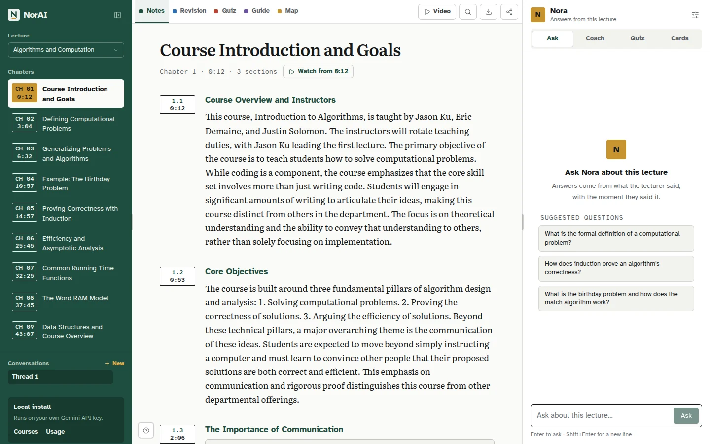
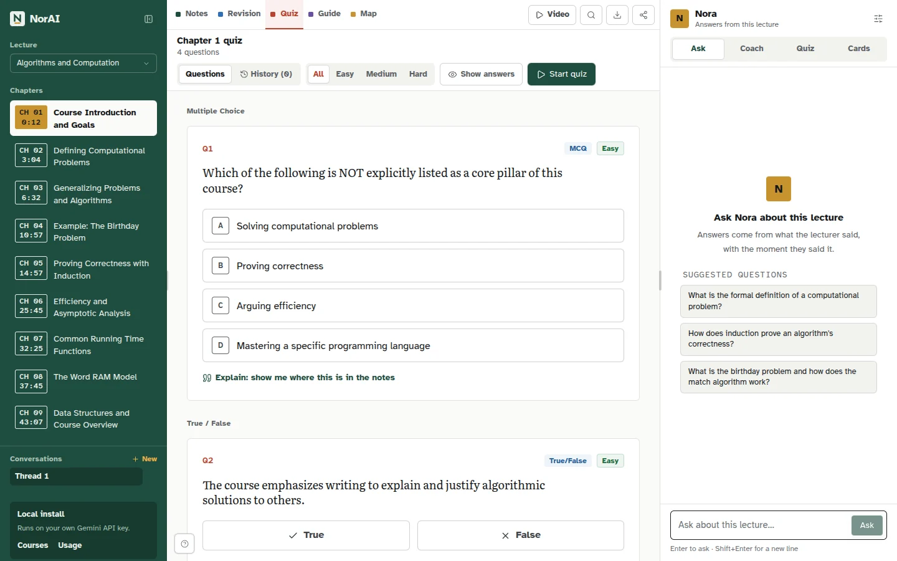
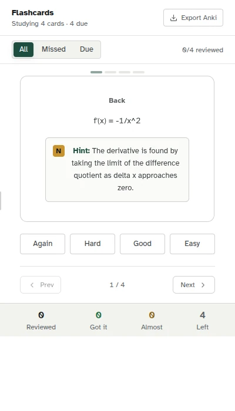
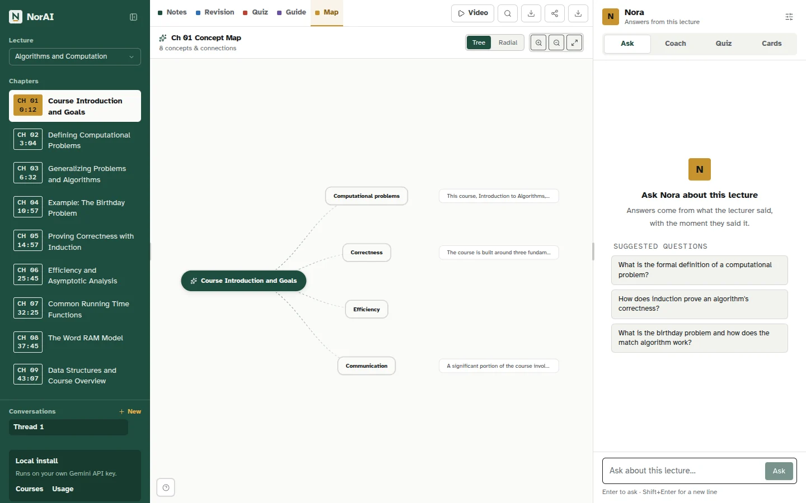
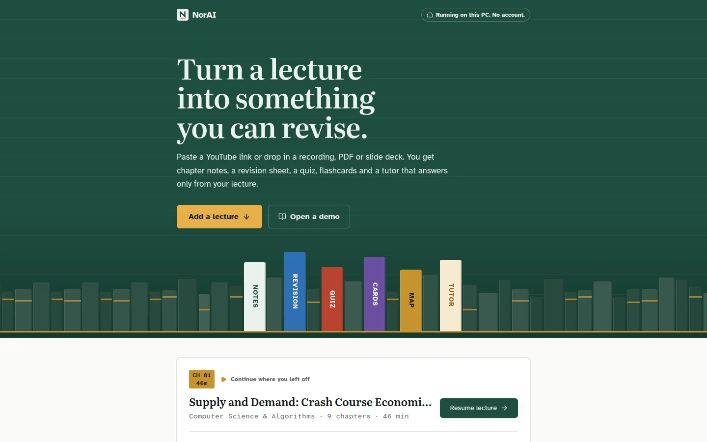

# NorAI

### Turn a lecture into something you can revise.

**NorAI turns a lecture video, recording, PDF or slide deck into chapter
notes, a revision sheet, a quiz, flashcards with spaced repetition, a mind
map, and a tutor (Nora) that answers only from that lecture and links every
answer back to the moment it was said.**

[](https://www.python.org/)
[](https://fastapi.tiangolo.com/)
[](https://react.dev/)
[](https://www.typescriptlang.org/)
[](https://ai.google.dev/)
[](https://www.langchain.com/langgraph)



*The workspace: chapters on the left, notes in the middle, Nora on the right.
Every note section carries its start time and a "Watch from" link into the video.*

## What you get from one lecture

| | |
|---|---|
| **Study notes** | Chapter by chapter, in the order the lecturer taught, with the slides and diagrams that mattered pulled out of the video |
| **Revision sheet** | A dense summary per chapter for the night before the exam |
| **Quiz** | MCQ, true/false and short-answer questions per chapter, with a "show me where this is in the notes" link on each |
| **Flashcards** | SM-2 spaced repetition with a Due filter and a missed-cards filter, plus **Anki `.apkg` export** |
| **Mind map** | A concept map per chapter (tree or radial), exportable |
| **Study guide** | All the revision notes joined into one document |
| **Nora, the tutor** | Answers only from this lecture, cites `m:ss` timestamps that are checked against the transcript, and says so when the lecture doesn't cover something. **Ask** mode answers; **Coach** mode guides you with questions. It replies in the language you write in |
| **Highlight & Ask** | Select any text in the notes and ask Nora about it |
| **Click-to-video** | Every note section and every tutor citation jumps the docked player to the exact moment |
| **PDF export** | Notes, revision, quiz and mind map, generated on demand through the browser print pipeline |
| **Library, courses, sharing** | A study home that surfaces due cards and missed questions, courses that group lectures, and share links that expose only sanitized content (no transcript, no answer key, no tutor) |
| **Usage page** | Per-stage Gemini token and cost breakdown |

<table>
<tr>
<td width="50%"><br><sub><b>Quiz</b> per chapter, with difficulty filters and a step-by-step quiz mode.</sub></td>
<td width="50%"><br><sub><b>Flashcards</b> with spaced repetition and Anki export.</sub></td>
</tr>
<tr>
<td width="50%"><br><sub><b>Mind map</b> of each chapter's concepts.</sub></td>
<td width="50%"><br><sub><b>Library</b> home: add a lecture or pick up where you left off.</sub></td>
</tr>
</table>

## Inputs

- **Video:** a YouTube link, an uploaded file (MP4, MOV, MKV, AVI, WebM), or a Google Drive link.
- **Documents:** PDF, DOCX, PPTX, TXT, Markdown, web pages, Google Docs/Slides and Dropbox links. Text is extracted (scanned PDFs go through Gemini), turned into transcript-shaped segments with a location label ("p. 4", "Slide 7"), and then runs through the same content stages as video.

Which sources are on is a setting (`NORAI_SOURCES`), not a code branch. See
[Two ways to run it](#two-ways-to-run-it).

## Run it on your own PC

You need Python 3.12+, Node.js 20.19+, FFmpeg and a free
[Gemini API key](https://aistudio.google.com/apikey).

```bash
git clone https://github.com/GouravLuinor/NorAI.git
cd NorAI
scripts/setup-local.sh        # installs everything, asks for your Gemini key
scripts/start-dev.sh start    # open http://localhost:5173
```

The setup script writes `.env` with `NORAI_MODE=local`: no sign-up, no quotas,
data in SQLite under `outputs/`, and every intake source on, YouTube included.
Processing spends your own Gemini quota (a 17-minute lecture is about 9 calls,
and the free tier allows a few long lectures a day). Google's free tier isn't
offered in the EEA, UK or Switzerland, where the key needs billing.
`scripts/start-dev.sh stop` shuts it down.

## Two ways to run it

One codebase, two settings, no edition branches.

| Setting | `local` | `hosted` (default) |
|---|---|---|
| `NORAI_MODE` | One user, no login, no quotas, SQLite | Supabase login, quotas, rate limits |
| `NORAI_SOURCES` | `youtube,gdrive,upload,link` | `gdrive,upload,link` (YouTube blocks server IPs) |
| Free allowance | None | 60 lecture-minutes every 30 days (`NORAI_FREE_MINUTES`) |
| Payments | n/a | Razorpay code exists but stays off (`ENABLE_PAYMENTS=0`) |

The backend refuses to start in local mode when `NORAI_ENV=production`, since
local mode switches off ownership checks. The frontend reads both settings
from `GET /system/config`. Details and status:
[`docs/INGESTION_PLAN.md`](docs/INGESTION_PLAN.md).

## How it works

```
Video ─► Ingest ─► Transcribe (compact [MM:SS] lines) ─┐
                   Keyframes (scene-change frames) ────┤  in parallel
                                                       ▼
Document ─► Extract ─► segments with a "p. 4" label ─► Structure (1 call: title + chapters)
                                                       ▼
                                  Chapters (1 multimodal call each, 3 at a time)
                                  notes · revision · quiz · flashcards · screenshot picks
                                                       ▼
                                  Tutor index (embedded on the box) ─► Cleanup
```

| Stage | What happens |
|---|---|
| **Ingest** | Resolve the source (`yt-dlp`, `gdown`, upload, or a safe-fetched link) and extract 16 kHz audio |
| **Transcription** | Gemini transcribes to `[MM:SS] text` lines, one per sentence (18-minute slices in parallel for long lectures). Timestamps land within about a second of YouTube's own captions |
| **Keyframes** | FFmpeg decodes only the video's keyframes, and pixel-diff scene detection keeps the distinct ones, so a slide shown for a few seconds is still captured |
| **Structure** | One call over the transcript decides the title, the number of chapters and their boundaries (about one per 4 minutes) |
| **Chapters** | One multimodal call per chapter: its transcript plus up to 12 of its keyframes in, notes (each section with its start time), revision, quiz, flashcards and screenshot picks with OCR out |
| **Tutor index** | ~45 s transcript windows, note sections and screenshot captions are embedded locally with EmbeddingGemma 300M (4-bit ONNX, multilingual). Ids are content-hashed, so re-indexing unchanged content embeds nothing |
| **Cleanup** | Deletes the video, audio and raw frames after success, failure or cancel |

Chapter results are cached by a hash of their inputs, so re-running a lecture
only pays for what changed, and a chapter that fails is marked degraded
instead of failing the lecture. The pipeline is synchronous and runs in a
worker thread owned by a DB-backed job queue (`backend/jobs.py`): jobs survive
restarts, progress is saved to the database, and the frontend polls it.

### The tutor

```
Question ─► rewrite ─► hybrid retrieval (BM25 + dense, RRF-fused) ─► grounded answer ─► citation check
            transcript windows · note sections · screenshots · conversation state
```

- A LangGraph graph per lecture with async nodes and an `AsyncSqliteSaver` checkpointer, so turns never block the event loop.
- A per-lecture vector index (`tutor/vector_store.py`: a float16 matrix plus `docs.json`, exact cosine, about 100 to 450 KB per lecture) fused with BM25.
- The tutor decides whether the lecture covers the question, partly covers it, doesn't cover it, or the question rests on a false premise. A deterministic post-check drops any citation that isn't in the transcript.
- Real token streaming through `graph.astream_events`.
- An offline eval harness in `tutor/evals/` scores answers and notes against the transcript.

### Cost and speed

Measured on `gemini-3.1-flash-lite`:

| Lecture | Gemini calls | Cost | Wall time |
|---|---|---|---|
| 17 min (calculus) | 9 | $0.0335 | 142 s |
| 8.7 min (DP), through the UI | 4 + embeddings | n/a | 115 s |

Embeddings now run on the box, so new lectures make 6 calls for 17 minutes.
The older 18-stage chain needed 29 calls and $0.061 for the same lecture. The
local stages cost under 0.3 CPU-seconds per lecture minute. `POST /estimate`
predicts calls and minutes before you start and recalibrates from recorded runs.
When Gemini returns repeated 503s the client falls over to `NORAI_FALLBACK_MODEL`
for a few minutes, and `NORAI_MODEL` swaps the model for a single run.

## Tech stack

| Layer | Technology |
|---|---|
| **Frontend** | React 19, TypeScript, Vite 8, Tailwind CSS 4, Zustand, React Router, React Markdown, KaTeX, Framer Motion |
| **Backend** | FastAPI, Uvicorn, SQLAlchemy (async), Alembic migrations |
| **AI** | Gemini (`gemini-3.1-flash-lite`) for transcription and notes; EmbeddingGemma 300M on ONNX Runtime for embeddings (`gemini-embedding-2` optional) |
| **Tutor** | LangGraph, LangChain, NumPy vector store, BM25 |
| **Media** | FFmpeg, OpenCV, yt-dlp, gdown |
| **Documents** | pypdfium2, python-docx, python-pptx, trafilatura |
| **Auth and data** | Supabase (JWT via JWKS, Postgres) when hosted; SQLite when local; artifacts on the file system |
| **Export** | genanki (Anki), browser print pipeline (PDF) |
| **Tooling** | oxlint, Vitest, standalone offline test scripts, GitHub Actions CI, single-container Dockerfile |

## Repository layout

```
NorAI/
├── config.py            # single source of truth: model, dirs, run mode, sources, quotas
├── backend/             # FastAPI app: main.py + routers/ (webhooks, billing, courses, quiz,
│                        #   content, tutor, study), orchestrator.py, jobs.py (queue),
│                        #   gemini_client.py (retry/RPM/fallback), access.py, usage*.py, db/
├── lean/                # the content stages: structure.py, chapters.py, pipeline.py
├── documents/           # PDF/DOCX/PPTX/web intake, SSRF-guarded fetch
├── ingest/  transcription/  chunking/  visual/        # video intake stages
├── notes/  revision_notes/  assessment/  flashcards/   # artifact writers, SM-2, Anki export
├── tutor/               # RAG tutor: graph, retriever, vector_store, local_embedding, evals/
├── frontend/            # React app (src/pages, components, stores) + prerender for SEO
├── migrations/          # Alembic
├── seed_data/           # five processed demo lectures (CC BY-NC-SA, credited in lectures.json)
├── scripts/             # setup-local.sh, start-dev.sh, run-tests.sh, entrypoint.sh
├── docs/                # architecture, plans, progress log, screenshots
├── Dockerfile  docker-compose.yml  .github/workflows/ci.yml
└── outputs/             # every generated artifact, per lecture (gitignored)
```

Each lecture is isolated under `outputs/<lecture-id>/` (transcripts, notes,
revision, assessment, flashcards, screenshots, tutor index and checkpoints).
Lecture identity follows through routes, stores, indexes, threads and PDFs, so
nothing leaks between lectures.

## Development

```bash
scripts/start-dev.sh start     # backend :8000 + frontend :5173, daemonized and idempotent
scripts/start-dev.sh status
scripts/run-tests.sh           # every offline backend test_*.py, plus pyflakes
cd frontend && npm run lint    # oxlint
cd frontend && npm run test    # Vitest
cd frontend && npm run build   # tsc -b + vite build + prerender
```

API docs are at http://localhost:8000/docs. There is no pytest: tests are
standalone `test_*.py` scripts, and CI runs them with the lint and build. The
full pipeline calls Gemini, so run it deliberately.

For a hosted setup, copy `.env.example` to `.env` and fill in the Gemini key
and your Supabase project (see [`SUPABASE_SETUP.md`](SUPABASE_SETUP.md)). The
agreed production path (single container, Caddy, Supabase) is in
[`docs/DEPLOYMENT_PLAN.md`](docs/DEPLOYMENT_PLAN.md).

## Docs

| | |
|---|---|
| [`AGENTS.md`](AGENTS.md) | Operational guide for contributors and coding agents |
| [`PRODUCT.md`](PRODUCT.md), [`DESIGN.md`](DESIGN.md) | Who it's for, and the "Stacks" design language |
| [`docs/PROJECT_PROGRESS.md`](docs/PROJECT_PROGRESS.md) | Living current-state log |
| [`docs/ROADMAP.md`](docs/ROADMAP.md) | Engineering-hardening plan and status |
| [`docs/INGESTION_PLAN.md`](docs/INGESTION_PLAN.md) | Local vs hosted editions and multi-format intake |
| [`docs/DEPLOYMENT_PLAN.md`](docs/DEPLOYMENT_PLAN.md) | Production deployment path |
| [`docs/NOTES.md`](docs/NOTES.md) | Fix log, pricing and decisions |
| [`docs/PHASE2_REPORT.md`](docs/PHASE2_REPORT.md) | Old pipeline vs lean pipeline: cost, quality, load |

## Security notes

- Keys live in environment variables; `.env` is gitignored.
- Webhook signatures are verified fail-closed; JWT verification is fail-closed (ES256 via JWKS, HS256 fallback).
- Every server-side fetch of a user URL goes through one SSRF-guarded download function.
- Uploads are validated and size-limited. Quota is enforced before any Gemini spend, and again on the real downloaded length.
- Raw error details go to logs; clients get generic messages.
- Share links are closed by default and expose sanitized content only.
- Before a public deployment: add rate limiting at the edge and tighten the deliberately broad dev CORS list.

## Roadmap

- [ ] Automated end-to-end tests for a full lecture run (the offline suites exist; live runs don't)
- [ ] Cloud object storage for artifacts
- [ ] Cross-lecture retrieval
- [ ] Weak-concept detection and personalized revision plans
- [ ] Multilingual lecture workflows
- [ ] Collaborative study rooms

## Author

Built by **Gourav Kumar Singh**. Issues, experiments and pull requests are
welcome, especially on retrieval quality, multimodal evaluation, accessibility
and pipeline recovery.

Code is released under the [MIT License](LICENSE).

*Demo lectures in `seed_data/` are from MIT OpenCourseWare and Yale Courses
(CC BY-NC-SA); sources and licences are listed in `seed_data/lectures.json`.*
